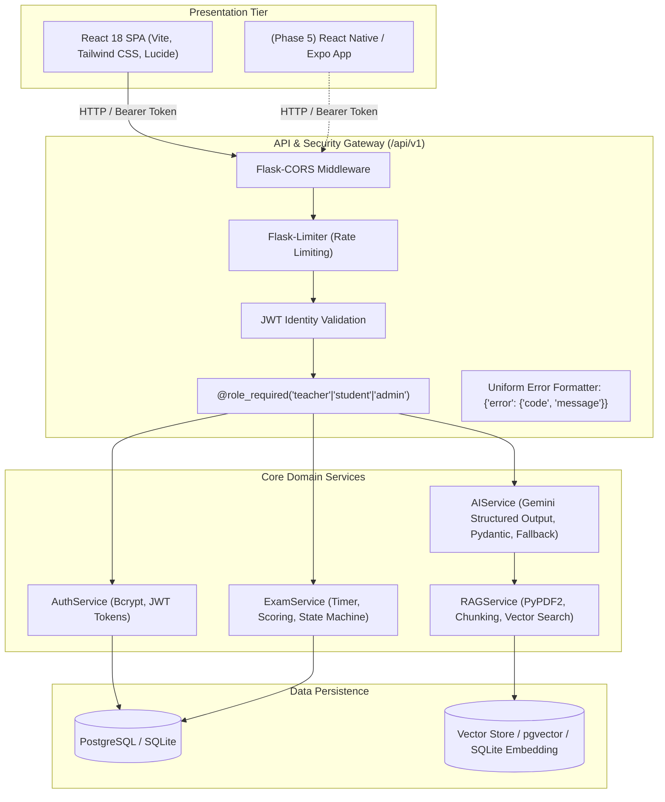
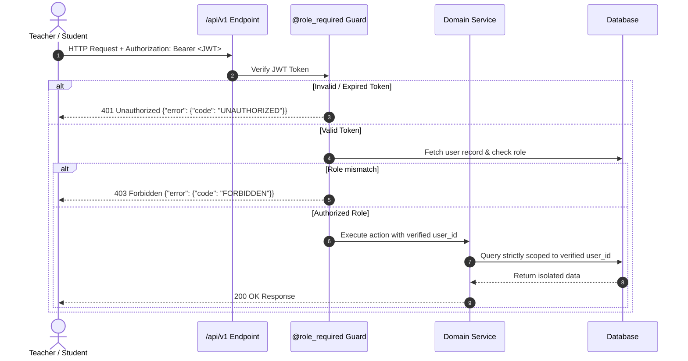
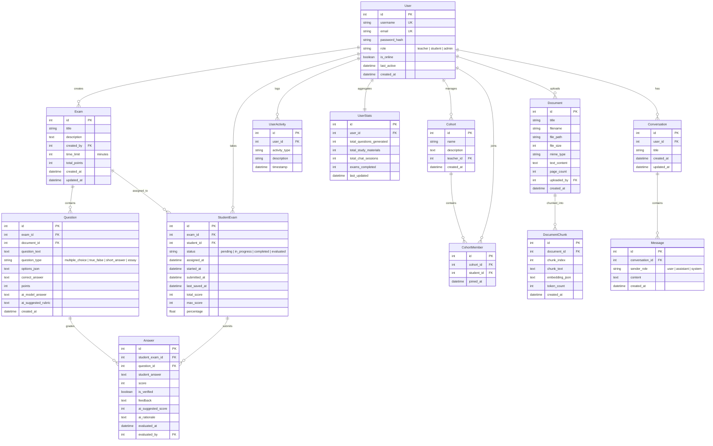

# 🏛️ EduTechAssistance Architecture & System Blueprint

## 1. High-Level Architecture

EduTechAssistance is built with a decoupled client-server architecture:
- **Presentation Layer**: React 18 SPA (Tailwind CSS, Lucide Icons, Axios).
- **Application & API Gateway**: Python Flask 2.3+ REST API running with Alembic, Flask-SQLAlchemy, Flask-JWT-Extended, and Flask-Limiter.
- **AI & RAG Engine**: Google Gemini (`gemini-2.5-flash`), with vector embedding storage, semantic retrieval, and local rule-based fallback.
- **Persistence Layer**: Relational database (SQLite for development, PostgreSQL with pgvector for production).

---

## 2. Authentication, Role Enforcement & Ownership Model

All security is token-driven. Client identity is derived strictly from the cryptographically verified JWT (`get_jwt_identity()`), **never** from request body parameters or query strings.

---

## 3. Relational Database Schema & Data Models

The system is normalized across 12 relational tables:

