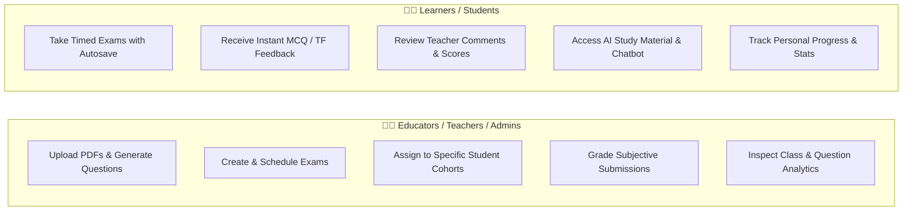
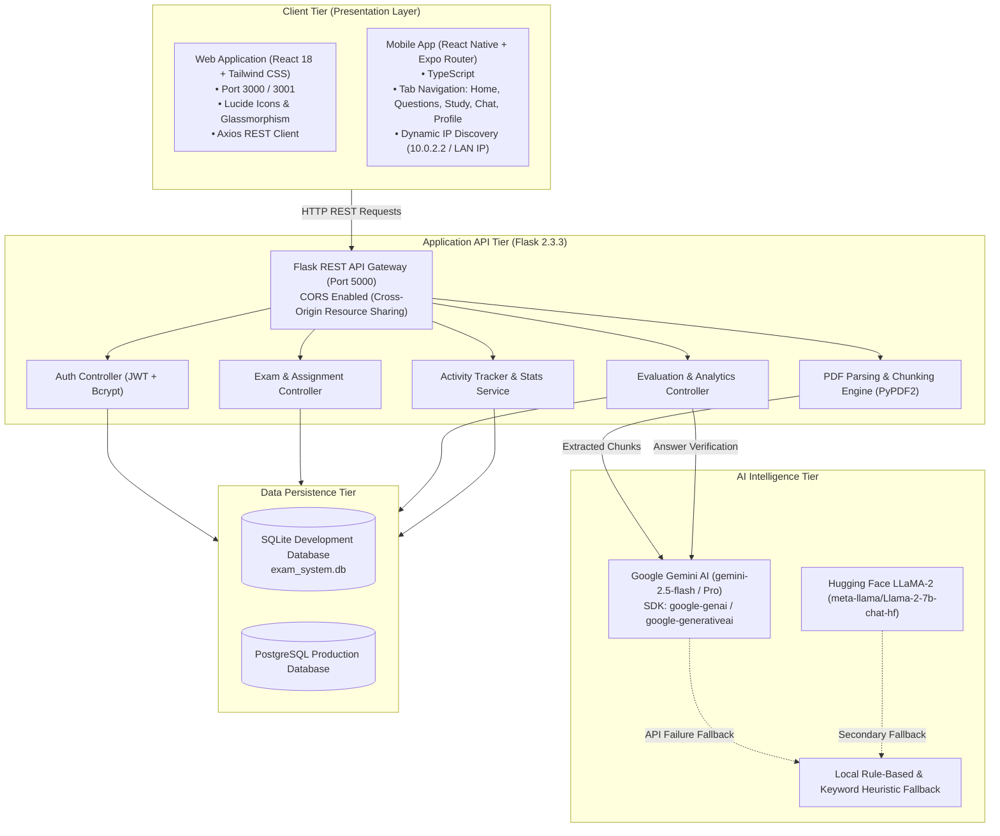
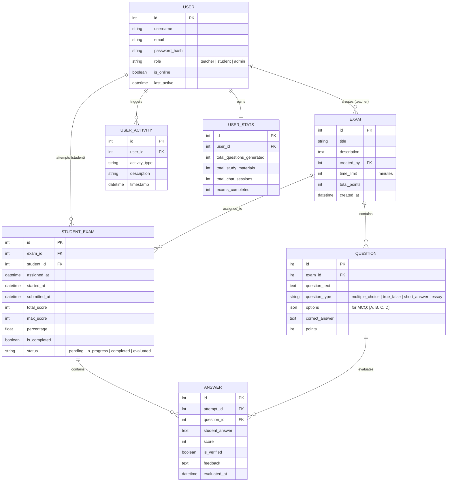

# 📖 EduTechAssistance: Complete System & Project Description

**Project Title**: AI-Powered Question Paper Generator & Comprehensive Exam Management System  
**Repository**: `developerskull/EduTechAssistance`  
**Version**: `3.0.0` (Production Architecture Blueprint)  
**System Type**: Full-Stack Multi-Platform Educational Technology Platform (Web, Mobile & REST API)  

---

## 1. Executive Summary & Project Vision

**EduTechAssistance** is an intelligent, dual-engine educational technology ecosystem designed to automate and modernize two foundational pillars of academic workflows:
1. **Intelligent Content Generation via RAG (Retrieval-Augmented Generation)**: Automatically analyzing instructional PDF documents (textbooks, lecture notes, syllabus guides) to generate structured, curriculum-aligned question papers and study materials using state-of-the-art Large Language Models (Google Gemini & Meta LLaMA-2).
2. **Complete Exam Lifecycle & Teacher Evaluation Management**: Providing a collaborative platform for educators to schedule assignments, conduct timed online examinations, leverage automated grading for objective questions (MCQs, True/False), manually grade subjective answers using side-by-side comparison rubrics, and inspect class-wide analytics.

---

## 2. User Roles & Personas

The system features strict **Role-Based Access Control (RBAC)** tailored to two primary user classes:



---

## 3. Comprehensive Feature Catalog

### 🤖 1. AI Content & Question Paper Generation
- **Drag-and-Drop Document Parsing**: Ingests PDF course documents up to 10MB using text extraction engines (`PyPDF2` on Python / `pdf-parse` on Node.js).
- **RAG Text Chunking & Context Structuring**: Cleans, partitions, and structures document context into semantic chunks for prompt synthesis.
- **Multi-Format Question Generation**:
  - **Multiple Choice Questions (MCQ)**: 4 options with single correct key.
  - **True / False Questions**: Rapid concept-check items.
  - **Short Answer Questions**: Definitional and explanatory items.
  - **Essay & Application Questions**: Analytical and synthesis-level prompts.
- **Difficulty & Bloom's Taxonomy Tuning**: Generates across configurable difficulty tiers: `Easy`, `Medium`, and `Hard`.
- **Topic-Wise Study Material Generator**: Synthesizes structured summaries, core formula cheat sheets, and conceptual study guides from document chunks.
- **AI Study Assistant (Chatbot)**: Real-time conversational tutor answering student queries regarding course content.

### 📝 2. Exam Creation & Assignment Workflow
- **2-Step Assignment Creation Wizard**:
  - *Step 1 (Curate)*: Configure title, description, time limits (minutes), question items, points per question, and model answers.
  - *Step 2 (Distribute)*: View registered/active students and assign the exam to individual students, specific groups, or all students with one click.
- **Question Customization**: Ability to mix AI-generated questions with custom teacher-authored questions.

### ⏱️ 3. Student Examination Experience
- **Dedicated Assessment Portal**: Clean, distraction-free examination taking environment.
- **Real-Time Countdown Timer**: Client-side countdown synced with server timestamps.
- **Smart Submission**: Auto-submits upon timer expiration or manual student confirmation.
- **Instant Objective Grading**: MCQs and True/False questions are graded instantly upon submission.
- **Results & Performance Review**: Students can inspect completed exams, breakdown of correct vs incorrect answers, teacher remarks, and overall percentage.

### ⚖️ 4. Teacher Evaluation & Analytics Suite
- **Pending Evaluation Queue**: Clear visual inbox displaying student submissions that contain ungraded subjective questions.
- **Side-by-Side Grading Workspace**:
  - Left/Top Pane: Correct model answer (highlighted in emerald green).
  - Right/Bottom Pane: Student's submitted text (highlighted in indigo blue).
  - Numeric score input with maximum validation.
  - Qualitative written feedback textarea.
- **Exam Overview Modal**:
  - Class statistics: Total submissions, class average score, percentage pass rate, pending reviews.
  - Question-by-question performance bar graphs.
  - Student roster with individual scores and evaluation statuses.
- **Question Analytics Modal**:
  - Deep-dive into specific question failure rates.
  - Distribution graphs showing which incorrect options students selected.
  - Accuracy percentage to detect flawed or overly difficult questions.

### 📊 5. Dynamic Dashboard & Activity Tracking
- **Real-Time Online Presence**: Live indicator tracking active and online students.
- **Activity Logger**: Persists user actions (`generate_questions`, `generate_study_content`, `submit_exam`, `evaluate_submission`, `chat_with_ai`).
- **Aggregated User Statistics**:
  - Total question papers generated.
  - Total study guides created.
  - Total AI chat sessions held.
  - Total exams completed and pending.

---

## 4. End-to-End System Architecture



---

## 5. Database Schema & Data Models

The data layer is managed via SQLAlchemy ORM with the following relational models:



---

## 6. Complete REST API Specifications

### System & Health Endpoints
- `GET /api/health`: Health status, active AI service, and version metadata.
- `GET /api/test-connection`: Connectivity verification for mobile and frontend clients.
- `GET /api/dashboard?user_id={id}`: Aggregated dashboard stats and activity feed.

### AI Generation Endpoints
- `POST /api/generate-questions`:
  - Input: `multipart/form-data` with `pdf` file, `title`, `description`, `difficulty`.
  - Output: JSON array of generated questions, question types, answer keys, and parsing metadata.
- `POST /api/generate-study-content`:
  - Input: `{ "topic": "string", "detail_level": "basic|intermediate|advanced" }`.
  - Output: Structured study guide, key takeaways, and practice exercises.
- `POST /api/chat-with-ai`:
  - Input: `{ "message": "string", "conversation_id": "string", "context": "string" }`.
  - Output: Streaming or JSON conversational response.

### Teacher Exam & Evaluation Endpoints
- `POST /api/teacher/create-assignment`: Create an exam with nested questions and point allocations.
- `POST /api/teacher/assign-to-students`: Distribute an exam to a list of student IDs (`student_ids: [2, 3, 4]`).
- `GET /api/teacher/pending-evaluations?teacher_id={id}`: Retrieve all attempts awaiting subjective grading.
- `GET /api/teacher/get-submission/{attempt_id}?teacher_id={id}`: Full submission with question keys and student answers.
- `POST /api/teacher/evaluate-answer`: Submit score and teacher commentary for a subjective answer.
- `GET /api/teacher/exam-overview/{exam_id}`: Class-wide analytics, average score, question accuracy rates.
- `GET /api/teacher/question-analytics/{exam_id}/{question_id}`: Answer breakdown, common misconceptions, error rates.

### Student Examination Endpoints
- `GET /api/student/my-assignments?student_id={id}`: List assigned exams with completion statuses.
- `POST /api/student/start-exam`: Begin timed exam session; returns questions without answer keys.
- `POST /api/student/submit-exam`: Submit answers; performs auto-grading on objective questions.
- `GET /api/student/my-results?student_id={id}`: Detailed scorecard, scores, and teacher comments.

---

## 7. Technology Stack Summary

| Layer | Component | Version | Role / Justification |
| :--- | :--- | :--- | :--- |
| **Frontend Web** | React | `18.2.0` | SPA with hook-based state management |
| | React Router DOM | `6.3.0` | Client-side routing across dashboards and modals |
| | Tailwind CSS | `3.3.0` | Utility styling with custom glassmorphic aesthetics |
| | Lucide React | `0.263.1` | Modern icon toolkit |
| | React Dropzone | `14.2.3` | Drag-and-drop PDF ingestion |
| | Axios | `1.4.0` | HTTP client communicating with Flask backend |
| **Mobile App** | React Native | `0.72+` | Cross-platform native mobile experience |
| | Expo Router | `latest` | File-based mobile routing across 5 main tabs |
| | TypeScript | `5.0+` | Type-safe mobile service client |
| **Backend API** | Python Flask | `2.3.3` | Lightweight, scalable REST microframework |
| | Flask-CORS | `4.0.0` | Cross-origin resource sharing support |
| | Flask-SQLAlchemy | `3.0.5` | ORM abstraction over SQLite/PostgreSQL |
| | Flask-JWT-Extended| `4.5.2` | Stateless authentication tokens |
| | Flask-Bcrypt | `1.0.1` | Secure password hashing |
| **AI / NLP** | Google Gemini AI | `gemini-2.5-flash` | Primary high-speed reasoning & question generation |
| | Hugging Face API | LLaMA-2 | Alternative LLM fallback |
| | PyPDF2 | `3.0.1` | PDF text extraction and parsing |
| **Database** | SQLite / Postgres | Dev / Prod | Relational storage for users, exams, and answers |

---

## 8. Current Implementation Status & Structural Audit

```text
========================================================================================
                              PROJECT REALITY CHECK
========================================================================================
DOCUMENTED BLUEPRINT:
   • Complete React 18 Web Client
   • Complete React Native Mobile App
   • Complete Flask 2.3.3 API with Gemini RAG
   • Complete Teacher Evaluation Workspace
   
ACTUAL REPOSITORY STATE:
   • Contains 37 files (documentation, fix logs, setup guides, root package.json)
   • Source code directories (src/, public/, python-backend/, QuestionGenMobileApp/)
     were omitted during initial GitHub web upload (commit: 3c21442).
   • System currently requires source restoration or re-scaffolding to run.
========================================================================================
```

For the full forensic audit, runtime diagnostic results, and step-by-step restoration plan, refer to [condition.md](file:///c:/Users/kunal/edutech/EduTechAssistance/condition.md).

