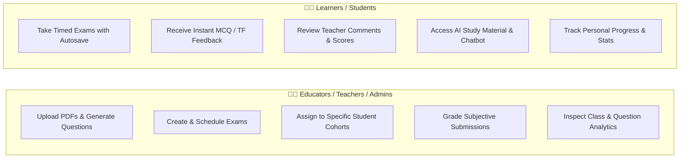
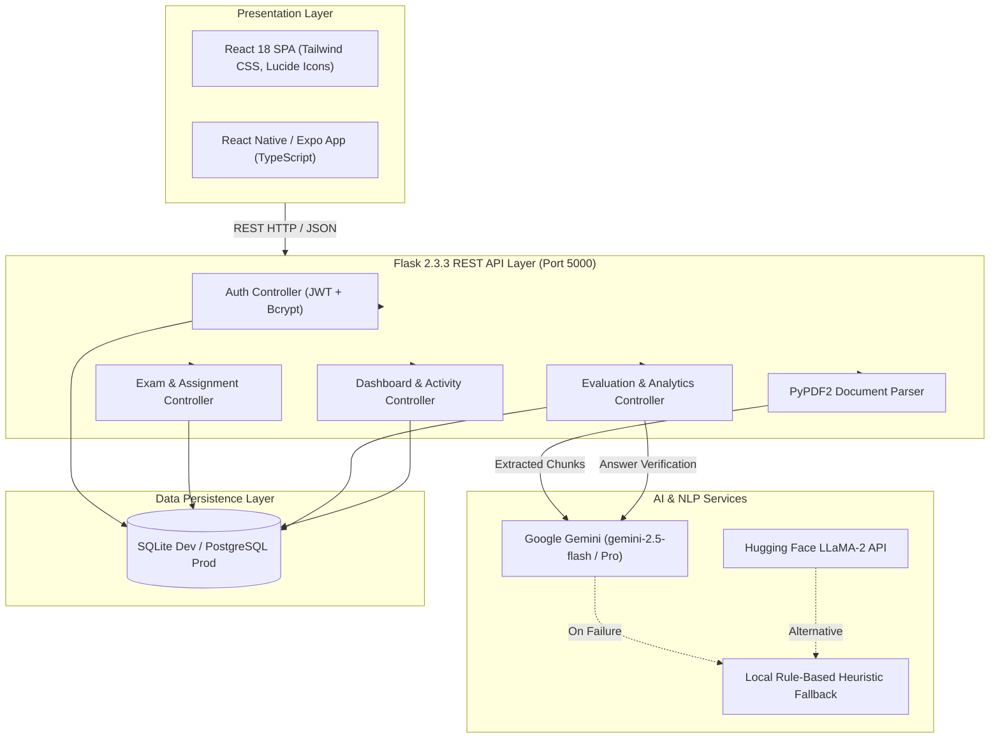
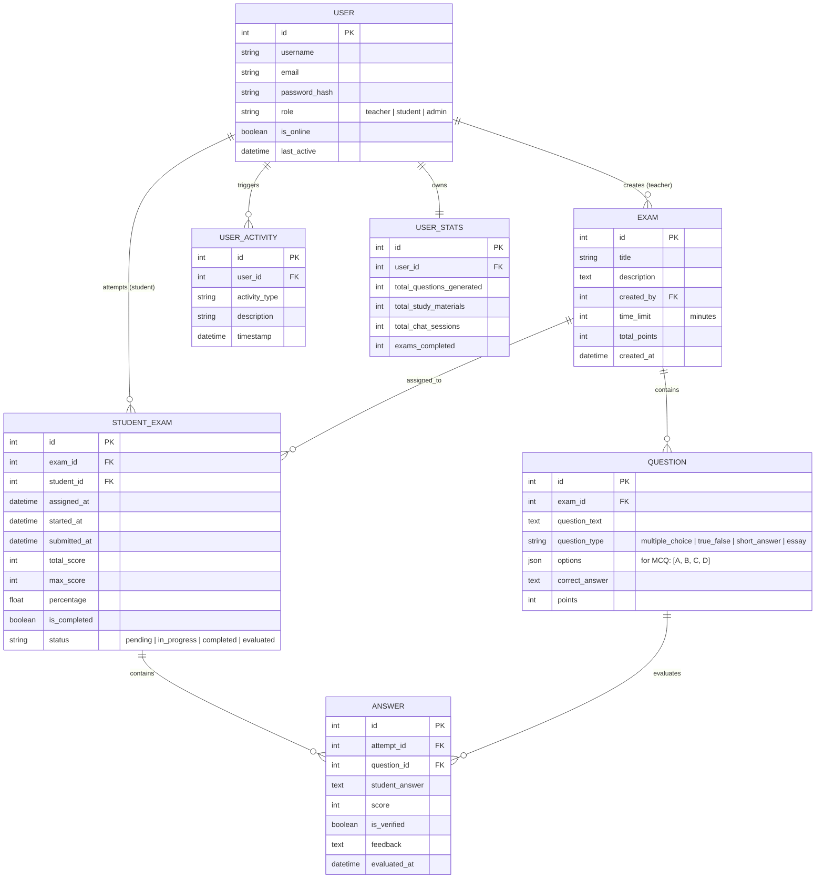

# 📋 Project Condition & Comprehensive System Description: EduTechAssistance

**Project Name**: AI-Powered Question Paper Generator & Comprehensive Exam Management System  
**Repository**: `developerskull/EduTechAssistance`  
**Target Environment**: Windows (Node v24.16.0, Python 3.12.10)  
**Report Generated**: November 2026  
**Status**: 🔴 **CRITICAL CONDITION / NON-FUNCTIONAL (Documentation Shell)**

---

## 1. Executive Summary

A comprehensive forensic audit of the **EduTechAssistance** project was conducted. The project is designed and documented as a sophisticated, full-stack, AI-driven educational platform comprising:
1. An **AI Question Paper Generator & RAG pipeline** (extracting context from PDFs via PyPDF2 / pdf-parse and generating questions using Google Gemini / LLaMA-2).
2. A **Teacher Assignment & Evaluation System** (creation, student assignment, automated MCQ/TF grading, manual short-answer evaluation with rubric comparison, and class analytics).
3. A **React 18 Web Frontend** with Tailwind CSS glassmorphic UI.
4. A **React Native / Expo Mobile Application** (`QuestionGenMobileApp`).
5. A **Flask REST API Backend** with SQLAlchemy and JWT authentication.

> [!CAUTION]
> **Core Finding**: The current repository is **non-executable**. It exists solely as a **documentation, configuration, and log repository**. None of the application source code directories (`src/`, `public/`, `python-backend/`, `backend/`, `QuestionGenMobileApp/`, `output/`) are present in the filesystem or Git commit history.
>
> Attempting to run `npm start`, `python fix_system.py`, `python test_backend_connection.py`, or any mobile script results in immediate failure due to missing source files and directories.

---

## 2. Comprehensive Description of the Whole Project

### 🌟 2.1 Project Purpose & Value Proposition
**EduTechAssistance** is an end-to-end educational technology platform designed to bridge content creation with academic assessment:
- **For Educators**: Eliminates manual question paper drafting by converting syllabus PDFs into balanced, multi-tier exam papers in seconds, while streamlining grading through auto-evaluation and comparative grading interfaces.
- **For Students**: Provides a modern test-taking portal with real-time feedback, automated score calculation, personalized study material generation, and an on-demand AI chatbot tutor.

---

### 👥 2.2 User Personas & Role-Based Permissions



1. **Teacher / Admin Persona**:
   - Access to Question Generation suite (PDF upload, prompt tuning).
   - Assignment authoring wizard with configurable time limits and point distributions.
   - Cohort assignment management (assigning to specific students).
   - Evaluation portal: side-by-side student answer vs. model answer review.
   - High-level analytics: class score distribution, question accuracy analysis.
2. **Student Persona**:
   - Personalized dashboard displaying assigned, active, and completed exams.
   - Timed examination interface with auto-save and submission protections.
   - Performance scorecard reviewing grades, question breakdowns, and teacher feedback.
   - AI Study Assistant for topic-based revision notes and interactive tutoring.

---

### 🧩 2.3 Functional Subsystems & Features

#### 1. AI Document Ingestion & RAG Pipeline
- **PDF Extraction**: Uploads documents up to 10MB; text extracted via `PyPDF2` (Python) or `pdf-parse` (Node.js).
- **Semantic Chunking**: Splits large documents into coherent sections to maintain context window efficiency.
- **Question Formulation**:
  - **Multiple Choice Questions (MCQ)**: 4 options with exact single answer key.
  - **True / False Questions**: Rapid conceptual verification items.
  - **Short Answer Questions**: Conceptual and definitional questions.
  - **Descriptive / Essay Questions**: Analytical multi-paragraph questions.
- **Difficulty Grading**: Configurable difficulty levels (`Easy`, `Medium`, `Hard`).

#### 2. AI Intelligence & Fallback Engine
- **Primary Model**: Google Gemini AI (`gemini-2.5-flash` / Gemini Pro) via `google-genai` / `google-generativeai`.
- **Secondary Model**: Meta LLaMA-2 (`meta-llama/Llama-2-7b-chat-hf`) via Hugging Face Inference API.
- **Local Fallback**: Rule-based keyword matching and pre-cached educational templates ensuring the platform remains operable even if API quotas or network connections drop.

#### 3. Exam Management & Assignment Workflow
- **2-Step Creation Wizard**:
  - *Step 1*: Author title, description, time limit (minutes), and question pool with individual point values.
  - *Step 2*: Select students from the active roster with instant assignment creation.
- **Status Tracking**: Tracks exam states across `pending`, `in_progress`, `completed`, and `evaluated`.

#### 4. Teacher Evaluation & Analytics Engine
- **Automated Grading**: MCQs and True/False questions are graded automatically and immediately upon submission.
- **Pending Review Queue**: Displays submissions containing pending subjective answers.
- **Comparative Grading Interface**:
  - Correct model answer displayed in green.
  - Student submitted answer displayed in blue.
  - Numeric score input with validation against max points.
  - Written teacher feedback textarea.
- **Exam Overview Modal**: Class statistics, submission counts, average score, and question performance bars.
- **Question Analytics Modal**: Deep-dive into specific question failure rates, answer distribution charts, and common student errors.

#### 5. Dynamic Dashboard & Activity Tracking
- **Online Presence Indicator**: Live monitoring of connected students.
- **Action Logging**: Persists user interactions (`UserActivity` model).
- **Aggregated Stats**: `UserStats` model tracks total questions generated, study materials created, chat sessions, and completed exams.

---

### 🏗️ 2.4 System Architecture



---

### 🗄️ 2.5 Database Schema & Relational Models



---

### 🔌 2.6 Complete REST API Specifications

| Method | Endpoint | Access Role | Description |
| :--- | :--- | :--- | :--- |
| `GET` | `/api/health` | Public | System status, AI availability, version metadata |
| `GET` | `/api/test-connection` | Public | Connectivity verification for mobile/frontend clients |
| `GET` | `/api/dashboard?user_id={id}` | Authenticated | Aggregated user stats and activity timeline |
| `POST` | `/api/generate-questions` | Teacher / Admin | Multipart PDF upload; extracts text and returns AI-generated questions |
| `POST` | `/api/generate-study-content` | Student / Teacher | Generates topic-wise educational summary and practice items |
| `POST` | `/api/chat-with-ai` | Student / Teacher | Interactive conversational educational tutor |
| `POST` | `/api/teacher/create-assignment` | Teacher / Admin | Creates an exam with nested questions and point allocations |
| `POST` | `/api/teacher/assign-to-students` | Teacher / Admin | Assigns exam to an array of student IDs |
| `GET` | `/api/teacher/pending-evaluations` | Teacher / Admin | Lists student submissions awaiting subjective grading |
| `GET` | `/api/teacher/get-submission/{id}` | Teacher / Admin | Detailed submission review with student answers and model answers |
| `POST` | `/api/teacher/evaluate-answer` | Teacher / Admin | Submits grade score and written commentary for an answer |
| `GET` | `/api/teacher/exam-overview/{id}` | Teacher / Admin | Class-wide submission metrics and score distributions |
| `GET` | `/api/teacher/question-analytics/{exam}/{q}` | Teacher / Admin | Accuracy rate, answer distribution, and misconception analysis |
| `GET` | `/api/student/my-assignments` | Student | List of assigned exams with status (`pending`, `completed`) |
| `POST` | `/api/student/start-exam` | Student | Initiates timed attempt; returns questions without answer keys |
| `POST` | `/api/student/submit-exam` | Student | Submits answers; auto-grades MCQs/TF, marks subjective as pending |
| `GET` | `/api/student/my-results` | Student | Retrieves scorecard, scores, and teacher feedback |

---

## 3. Overall Health Scorecard

| Category | Status | Rating | Assessment Summary |
| :--- | :---: | :---: | :--- |
| **Source Code Availability** | ❌ Missing | **0 / 10** | Core source directories (`src/`, `python-backend/`, `mobile`) do not exist. |
| **Documentation & Specs** | 🟢 Exceptional | **9.8 / 10** | Exhaustive API docs, architectural blueprints, UI guides, and change logs. |
| **Build & Run Readiness** | 🔴 Inoperable | **0 / 10** | `react-scripts` cannot find entry points; Flask app is absent; dependencies missing. |
| **Dependency Health** | 🟡 Outdated / Conflicted | **3 / 10** | Node 24 incompatibility with `react-scripts 5.0.1`; Python 3.12 missing libraries. |
| **Architecture Design** | 🟢 Robust | **9 / 10** | Well-conceived RAG workflow, evaluation pipeline, fallback AI, and role separation. |
| **Security & Secrets** | 🟡 Moderate Risk | **4 / 10** | Dummy keys in `.env`; hardcoded user ID bypasses in documented patches (`ID: 100`, `ID: 1`). |
| **Overall Project Grade** | 🔴 **CRITICAL** | **4.3 / 10** | High conceptual value; requires source code recovery or complete scaffolding. |

---

## 4. Forensic Codebase Audit (What Is Present vs. Missing)

### Git History
- **Branch**: `main` (up to date with `origin/main`)
- **Total Commits**: 1 commit (`3c21442 Add files via upload` on Dec 27, 2025 by Kunal Ahire)
- **Origin**: `https://github.com/developerskull/EduTechAssistance.git`
- **Upload Mechanism**: Web-based GitHub direct file upload (skipped subdirectories and nested folders).

### Inventory Breakdown (38 Files Total)

| Type | Files Present | Condition & Notes |
| :--- | :--- | :--- |
| **Configuration** | `package.json`, `package-lock.json`, `postcss.config.js`, `tailwind.config.js`, `.env`, `.env.example` | Valid config files, but reference nonexistent directories (`QuestionGenMobileApp`) and entry points. |
| **Python Utilities** | `fix_system.py`, `test_backend_connection.py` | Standalone scripts. Both fail immediately because backend paths and server targets are missing. |
| **Project Specifications** | `PROJECT_DESCRIPTION.md`, `PROJECT_REPORT.json`, `SYSTEM_OVERVIEW.md`, `TEACHER_EVALUATION_API.md` | In-depth technical specifications with complete schema and route documentation. |
| **Fix Logs & Guides** | `ASSIGNMENT_WORKFLOW_FIXED.md`, `AUTHORIZATION_FIX.md`, `BACKEND_INSTALL_FIX.md`, `CONNECTION_STATUS_UPDATE.md`, `DYNAMIC_DASHBOARD_IMPLEMENTATION.md`, `ENHANCED_COLOR_SYSTEM.md`, `ENHANCED_EVALUATION_FEATURES.md`, `ESLINT_FIXES.md`, `GEMINI_FIX_COMPLETE.md`, `GEMINI_SETUP_GUIDE.md`, `HOW_TO_RUN.md`, `MOBILE_APP_FIXED.md`, `NETWORK_CONNECTION_FIX.md`, `QUICK_START_GUIDE.md`, `SETUP_GUIDE.md`, `TEACHER_EVALUATION_WEB_GUIDE.md`, `WEB_INTERFACE_GUIDE.md` | High-fidelity logs recording debugging history, UI component breakdowns, and API contracts. |
| **Corrupted / Empty Files** | `LINKEDIN_PROJECT_SHOWCASE.json` (0 B)<br>`TEACHER_EVALUATION_SUMMARY.md` (0 B)<br>`WEB_IMPLEMENTATION_COMPLETE.txt` (0 B)<br>`TEACHER_SYSTEM_READY.md` (88 B incomplete) | Stubs created with zero bytes or incomplete headers. |

### Missing Component Matrix

```
Expected Project Structure (from documentation)          Actual Workspace Reality
├── python-backend/                                        ❌ MISSING
│   ├── app.py                                             ❌ MISSING
│   ├── models.py                                          ❌ MISSING
│   ├── auth.py                                            ❌ MISSING
│   ├── exam_routes.py                                     ❌ MISSING
│   ├── answer_routes.py                                   ❌ MISSING
│   ├── dashboard_routes.py                                ❌ MISSING
│   ├── llama_verifier.py / gemini_question_generator.py   ❌ MISSING
│   ├── services/                                          ❌ MISSING
│   └── requirements.txt                                   ❌ MISSING
├── src/                                                   ❌ MISSING
│   ├── App.js                                             ❌ MISSING
│   ├── index.js                                           ❌ MISSING
│   └── components/                                        ❌ MISSING
│       ├── ExamOverviewModal.js                           ❌ MISSING
│       ├── QuestionAnalyticsModal.js                      ❌ MISSING
│       ├── TeacherEvaluationDashboard.js                  ❌ MISSING
│       ├── CreateAssignmentModal.js                       ❌ MISSING
│       ├── EvaluateSubmissionModal.js                     ❌ MISSING
│       └── StudentAssignments.js                          ❌ MISSING
├── public/                                                ❌ MISSING
│   └── index.html                                         ❌ MISSING
├── QuestionGenMobileApp/                                  ❌ MISSING
└── output/ (screenshot artifacts)                         ❌ MISSING
```

---

## 5. Critical Issues, Risks & Technical Debt

### 1. Fatal Runtime Blockers
- **Missing Entry Points**: Any build or start command (`npm start`, `node`, `python app.py`) throws `ENOENT` / file-not-found errors.
- **`package.json` Execution Failure**: Running `npm test` or `npm start` immediately fails because `react-scripts` requires `public/index.html` and `src/index.js`.
- **Script Policy on Windows**: PowerShell execution policy (`PSSecurityException`) prevents executing `npm.ps1` directly; commands must use `cmd /c npm`.

### 2. Dependency & Environment Incompatibilities
- **Node.js v24.16.0 Conflict**: `package.json` uses `react-scripts 5.0.1` and `react 18.2.0`. Node 24 drops older OpenSSL and crypto algorithms used by Webpack 5 within `react-scripts`, typically requiring legacy flags (`NODE_OPTIONS=--openssl-legacy-provider`) or migration to Vite.
- **Python 3.12 Missing Libraries**: The system environment lacks `flask`, `google-genai`, `flask-sqlalchemy`, `flask-jwt-extended`, and `flask-bcrypt`.
- **Legacy `dlib` Pitfall**: Early backend designs required `dlib` for face recognition/proctoring, which fails to compile on Windows without Visual C++ build tools and CMake.

### 3. Security & Code Hygiene Risks
- **Secret Management**: Root `.env` and `.env.example` expose placeholder API keys (`REACT_APP_GEMINI_API_KEY=your_gemini_api_key_here`). In a production React client, keys prefixed with `REACT_APP_` are embedded in the client bundle and exposed to all visitors. AI generation should strictly occur on the backend.
- **Authentication Bypass in Patches**: In `AUTHORIZATION_FIX.md`, hardcoded demo IDs (`TEACHER_ID = 100`, `STUDENT_ID = 1`) were used to bypass role authorization bugs. If implemented permanently, this creates authorization vulnerabilities.

---

## 6. Prioritized Restoration & Remediation Roadmap

To bring this project from its current non-functional condition to a fully operational production state:

### Phase 1: Source Code Recovery
1. **Locate Local Source Repository**:
   - Check developer workstations, alternative branches, or local Git repositories where the files were originally drafted before the single GitHub web upload.
2. **If Source Is Unrecoverable**:
   - Reconstruct the project using the architectural specifications in `PROJECT_DESCRIPTION.md`, `PROJECT_REPORT.json`, and `TEACHER_EVALUATION_API.md`.

### Phase 2: Backend Reconstruction (`python-backend/`)
1. Create `python-backend/` directory structure:
   - `app.py`: Flask application factory, CORS setup, and blueprint registration.
   - `models.py`: SQLAlchemy models for `User`, `Exam`, `Question`, `StudentExam`, `Answer`, `UserActivity`, `UserStats`.
   - `routes/`: Modular blueprints (`auth_routes.py`, `teacher_routes.py`, `student_routes.py`, `ai_routes.py`, `dashboard_routes.py`).
   - `services/`: `gemini_service.py` (using official `google-genai` SDK), `pdf_service.py` (`pypdf`), and `fallback_service.py`.
2. Pin modern dependencies in `python-backend/requirements.txt`:
   ```text
   Flask>=3.0.0
   Flask-CORS>=4.0.0
   Flask-SQLAlchemy>=3.1.0
   Flask-JWT-Extended>=4.6.0
   Flask-Bcrypt>=1.0.1
   python-dotenv>=1.0.0
   google-genai>=0.1.0
   pypdf>=4.0.0
   requests>=2.31.0
   ```

### Phase 3: Modernizing Frontend (`client/` or `src/`)
1. **Migrate to Vite**:
   - Replace outdated `react-scripts 5.0.1` with **Vite 5+ / React 18+**, eliminating Node 24 incompatibility and providing sub-second build and HMR times.
2. **Re-implement Components**:
   - `ExamOverviewModal.jsx`, `QuestionAnalyticsModal.jsx`, `TeacherEvaluationDashboard.jsx`, `CreateAssignmentModal.jsx`, `StudentAssignments.jsx`.
3. **Secure API Key Handling**:
   - Remove `REACT_APP_GEMINI_API_KEY` from frontend. All Gemini AI calls must route through the Flask API (`/api/generate-questions`, `/api/chat`).

### Phase 4: Mobile App Alignment (`mobile/`)
1. Re-initialize `QuestionGenMobileApp` via modern Expo SDK (`npx create-expo-app@latest`).
2. Integrate tab routing (`app/(tabs)/index.tsx`, `questions.tsx`, `study.tsx`, `chat.tsx`, `profile.tsx`).
3. Implement dynamic IP detection for Android emulator (`10.0.2.2:5000`) and physical devices (`192.168.x.x:5000`).

### Phase 5: Repository Hygiene & Maintenance
1. Delete or populate empty stub files (`LINKEDIN_PROJECT_SHOWCASE.json`, `TEACHER_EVALUATION_SUMMARY.md`, `WEB_IMPLEMENTATION_COMPLETE.txt`).
2. Update `README.md` to reflect the single unified backend (Google Gemini on Flask) and deprecate legacy Node.js backend references.
3. Configure `.gitignore` to prevent committing secrets, virtual environments (`venv/`), build outputs (`dist/`, `build/`), and `node_modules/`.

---

## 7. Diagnostic Verification Matrix

| Diagnostic Check | Executed Command | Result | Action Required |
| :--- | :--- | :---: | :--- |
| **System Fix Script** | `python fix_system.py` | ❌ Failed | Blocked by missing `python-backend/app.py`. |
| **Backend Connectivity** | `python test_backend_connection.py` | ❌ Failed | No backend listening on port 5000. |
| **Web Frontend Build** | `cmd /c npm start` | ❌ Failed | Missing `public/index.html` and `src/`. |
| **Mobile App Launch** | `npm run mobile` | ❌ Failed | Missing `QuestionGenMobileApp` folder. |
| **Python Environment** | Package import probe | ⚠️ Incomplete | `flask`, `google.genai`, `sqlalchemy` not installed. |

---

## 8. Summary Conclusion

The **EduTechAssistance** project possesses a well-researched, high-quality architectural foundation and detailed functional specifications for an AI-powered education and evaluation platform. However, because only documentation and configuration files were uploaded to the repository, **the project is currently in a critical, non-functional condition**. Restoration requires retrieving the original source tree or re-scaffolding the client and server according to the comprehensive specifications preserved in the documentation.
